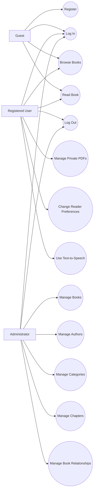

# Digital Library — Use Cases

**Project:** Digital Library  
**Document:** Use Case Specification  
**Document Version:** 1.0  
**Release Scope:** Version 1 (V1)  
**Status:** Active

---

## 1. Purpose

This document describes how users and administrators interact with the Digital Library system.

It identifies the actors, goals, preconditions, main success flows, alternate flows, and expected outcomes of the principal use cases.

These use cases define intended behavior. They do not prove that every described capability has been implemented. Actual routes, permissions, and feature availability must be verified against the current source code and test evidence.

---

## 2. Scope

The use cases cover:

- Account registration and authentication.
- User logout.
- Browsing and viewing books.
- Reading supported content.
- Administrative book management.
- Author and category management.
- Chapter management.
- Book relationship and visibility management.
- Private PDF management.
- Reader preferences.
- Text-to-speech where supported.
- Error handling and access restrictions.

Future capabilities such as AI-based recommendations, semantic search, chapter translation, and OCR for scanned PDFs are not assumed to be part of V1.

---

## 3. Actors

### 3.1 Guest

A visitor who is not currently authenticated.

A guest can access only public operations permitted by the system's visibility rules.

### 3.2 Registered User

An authenticated user with the USER role.

A registered user can access permitted library features and their own private resources where supported.

### 3.3 Administrator

An authenticated user with the ADMIN role.

An administrator can perform the administrative operations granted by the backend authorization rules.

Administrative privileges must not automatically be interpreted as unrestricted access to every user's private files.

### 3.4 Browser

The web browser displays the frontend and supports browser capabilities used by the application, including speech synthesis where available.

The browser is an external system actor rather than an application user role.

### 3.5 MySQL Database

MySQL stores the structured records used by the application. It is an external system component involved in the use-case execution flows.

---

## 4. Actor and Use-Case Overview

| Actor | Use cases |
|---|---|
| Guest | Register, log in, browse publicly accessible books, view permitted book details |
| Registered User | Log out, read accessible content, manage personal PDFs where supported, use reader preferences |
| Administrator | Manage books, authors, categories, chapters, relationships, and publication state where authorized |
| Browser | Display pages, submit requests, render supported content, provide speech capabilities |
| MySQL Database | Persist records, retrieve records, enforce configured data constraints |

An operation may be restricted to a particular actor even if the frontend displays a related control.

---

## 5. Use-Case Diagram

The following diagram provides a high-level view of the main actors and use cases.

**Note:** The diagram shows conceptual relationships, not a guarantee that every action is currently implemented or available to every role. Actual permissions and public-content rules must be verified.

---

## 6. UC-01 — Register an Account

**Primary actor:** Guest

**Goal:** Create a user account.

**Preconditions:**
- The registration feature is available.
- The guest can access the registration interface.

**Trigger:** The guest submits the registration form.

### Main success flow

1. The guest opens the registration page.
2. The system displays the required registration fields.
3. The guest enters the requested information.
4. The frontend submits the registration request.
5. The backend validates the input.
6. The backend checks account uniqueness requirements.
7. The backend securely hashes the password.
8. The backend creates the account.
9. The system returns an appropriate success response.
10. The frontend displays confirmation.

### Alternate flows

- **A1 — Invalid input:** The backend rejects the request and returns validation errors.
- **A2 — Duplicate account:** The system rejects the conflicting registration.
- **A3 — Database failure:** The system reports a suitable error without exposing sensitive details.
- **A4 — Missing fields:** The system rejects incomplete input where fields are required.

**Postconditions:**
- On success, the account is stored.
- On failure, the system must not report successful account creation.

**Related requirements:** Authentication, validation, data integrity, and password security.

---

## 7. UC-02 — Log In

**Primary actor:** Guest

**Goal:** Authenticate using valid account credentials.

**Preconditions:**
- An account exists.
- The login endpoint is available.

**Trigger:** The guest submits login credentials.

### Main success flow

1. The guest opens the login page.
2. The guest enters the required credentials.
3. The frontend sends the login request.
4. The backend validates the request.
5. The backend locates the account.
6. The backend verifies the submitted password against the stored password hash.
7. The backend establishes authentication using the configured mechanism.
8. The system returns the appropriate response.
9. The frontend transitions to the permitted authenticated experience.

### Alternate flows

- **A1 — Invalid credentials:** Authentication is rejected.
- **A2 — Invalid request:** The backend returns a validation error.
- **A3 — Rate limit exceeded:** The request is rejected according to the configured policy.
- **A4 — Database failure:** The system reports an appropriate error.
- **A5 — Disabled or otherwise ineligible account:** The request is rejected if such account states are supported.

**Postconditions:**
- On success, the client receives the configured authentication state.
- On failure, no valid authenticated state should be granted.

**Related requirements:** Authentication, rate limiting, secure cookies or tokens, and error handling.

---

## 8. UC-03 — Log Out

**Primary actor:** Authenticated user

**Goal:** End the authenticated session or token lifecycle supported by the application.

**Preconditions:**
- The user is authenticated, unless the implementation permits an idempotent logout request.

**Trigger:** The user activates the logout control.

### Main success flow

1. The user selects Log Out.
2. The frontend sends the logout request according to the API contract.
3. The backend applies the configured logout behavior.
4. The client clears or invalidates its authentication state as appropriate.
5. The frontend returns the user to a suitable public or unauthenticated page.

### Alternate flows

- **A1 — Missing authentication:** The backend responds according to the logout endpoint contract.
- **A2 — Network failure:** The frontend displays an appropriate failure or retry state.
- **A3 — Repeated logout:** The system behaves according to the documented endpoint semantics.

**Postconditions:**
- The client should no longer use the previous authenticated state.
- Server-side invalidation behavior depends on the implemented authentication design.

**Implementation note:** If logout relies on an in-memory token blacklist, its behavior across server restarts must be considered separately. Do not assume persistent token revocation unless it is implemented.

---

## 9. UC-04 — Browse Books

**Primary actor:** Guest or Registered User

**Goal:** Discover books available to the current actor.

**Preconditions:**
- The book catalogue endpoint is available.

**Trigger:** The actor opens the library or submits a search or filter request.

### Main success flow

1. The actor opens the book catalogue.
2. The frontend requests the available book records.
3. The backend validates pagination and filter parameters.
4. The backend retrieves records allowed by the visibility rules.
5. The backend returns the result in the documented response format.
6. The frontend displays the returned books.
7. The actor may change supported filters or pagination.

### Alternate flows

- **A1 — No matching records:** The frontend displays an empty-state message.
- **A2 — Invalid parameters:** The backend returns a validation error or applies documented defaults.
- **A3 — Database failure:** The frontend displays an appropriate error.
- **A4 — Restricted content:** The backend excludes or denies access to content the actor is not permitted to view.

**Postconditions:**
- No unauthorized records are exposed.
- The displayed results reflect the response returned by the backend.

---

## 10. UC-05 — View Book Details

**Primary actor:** Guest or Registered User

**Goal:** View details of a book that the actor is allowed to access.

**Preconditions:**
- The requested book exists and is accessible to the actor.

**Trigger:** The actor selects a book.

### Main success flow

1. The actor selects a book from the catalogue.
2. The frontend requests the book details.
3. The backend validates the book identifier.
4. The backend checks resource visibility and access permissions.
5. The backend retrieves the permitted metadata and relationships.
6. The frontend displays the book details.

### Alternate flows

- **A1 — Invalid identifier:** The request is rejected according to the API contract.
- **A2 — Book not found:** The backend returns the documented not-found response.
- **A3 — Restricted book:** Access is denied or the resource is not exposed.
- **A4 — Related data unavailable:** The system handles the failure without falsely presenting incomplete data as complete.

**Postconditions:**
- Only permitted book information is returned.

---

## 11. UC-06 — Read Book Content

**Primary actor:** Guest or Registered User, subject to content access rules

**Goal:** Read supported book or chapter content.

**Preconditions:**
- The content exists.
- The actor is permitted to access it.
- The reader interface is available.

**Trigger:** The actor selects the reading action.

### Main success flow

1. The actor opens an accessible book.
2. The actor selects a chapter or supported reading section.
3. The frontend requests the content.
4. The backend checks visibility and authorization.
5. The backend returns the supported content.
6. The frontend renders the content in the reader.
7. The actor reads and navigates through the available content.
8. The actor may adjust supported reader settings.

### Alternate flows

- **A1 — Content unavailable:** The system displays a suitable message.
- **A2 — Access denied:** The backend rejects unauthorized retrieval.
- **A3 — Unsupported content format:** The system reports that the content cannot be displayed.
- **A4 — Network failure:** The frontend communicates the failure and permits retry where appropriate.

**Postconditions:**
- Accessible content is displayed.
- Restricted content remains protected.

---

## 12. UC-07 — Manage Books

**Primary actor:** Administrator or another explicitly authorized role

**Goal:** Create, inspect, update, or remove book records as permitted.

**Preconditions:**
- The actor is authenticated.
- The actor has the necessary permission.
- Required database dependencies are available.

**Trigger:** The actor submits a book-management action.

### Main success flow

1. The actor opens the book-management interface.
2. The actor selects a permitted operation.
3. The frontend submits the relevant book data.
4. The backend validates the request.
5. The backend verifies authorization.
6. The service layer applies business rules.
7. The data-access layer performs the database operation.
8. The backend returns the operation result.
9. The frontend displays the result.

### Alternate flows

- **A1 — Unauthorized actor:** The backend denies the operation.
- **A2 — Invalid data:** Validation errors are returned.
- **A3 — Missing referenced record:** The operation is rejected.
- **A4 — Duplicate or conflicting data:** The operation follows the documented integrity rules.
- **A5 — Database failure:** The system reports failure and preserves consistency.

**Postconditions:**
- Successful changes are persisted.
- Failed operations are not falsely reported as successful.

---

## 13. UC-08 — Manage Authors

**Primary actor:** Administrator or another explicitly authorized role

**Goal:** Manage author records and supported book-author relationships.

**Preconditions:**
- The actor has the required permission.
- The author-management functionality is available.

**Trigger:** The actor submits an author-management action.

### Main success flow

1. The actor opens author management.
2. The actor chooses a permitted operation.
3. The actor enters or updates author information.
4. The backend validates the request.
5. The backend verifies permissions.
6. The backend performs the authorized database operation.
7. The frontend displays the result.

### Alternate flows

- **A1 — Invalid author data:** The request is rejected.
- **A2 — Unauthorized action:** Access is denied.
- **A3 — Referenced author:** Deletion follows the configured relationship and integrity rules.
- **A4 — Database error:** A suitable failure response is returned.

**Postconditions:**
- Author records and relationships remain consistent.

---

## 14. UC-09 — Manage Categories

**Primary actor:** Administrator or another explicitly authorized role

**Goal:** Create, update, view, or delete categories as permitted.

**Preconditions:**
- The actor has the necessary permission.

**Trigger:** The actor submits a category-management action.

### Main success flow

1. The actor opens category management.
2. The actor selects an operation.
3. The actor submits category information.
4. The backend validates the input and permission.
5. The backend applies the operation.
6. The frontend displays the result.

### Alternate flows

- **A1 — Invalid category data:** The request is rejected.
- **A2 — Unauthorized operation:** Access is denied.
- **A3 — Category has associated books:** The configured deletion policy is applied.
- **A4 — Database failure:** The system returns an appropriate error.

**Postconditions:**
- Category records and book-category relationships remain consistent.

---

## 15. UC-10 — Manage Chapters

**Primary actor:** Administrator or another explicitly authorized role

**Goal:** Manage chapters associated with a book.

**Preconditions:**
- The actor has the required permission.
- The parent book exists for operations that require it.

**Trigger:** The actor submits a chapter-management action.

### Main success flow

1. The actor opens chapter management.
2. The actor selects a parent book.
3. The actor selects a chapter operation.
4. The actor submits the chapter data.
5. The backend validates the data and parent relationship.
6. The backend verifies permissions.
7. The backend performs the operation.
8. The frontend displays the result.

### Alternate flows

- **A1 — Parent book not found:** The operation is rejected.
- **A2 — Invalid chapter data:** The backend returns validation errors.
- **A3 — Unauthorized actor:** The operation is denied.
- **A4 — Invalid ordering or conflicting data:** The documented business rules are applied.
- **A5 — Database failure:** The system reports failure.

**Postconditions:**
- Chapter records remain associated with valid parent records.

---

## 16. UC-11 — Manage Book Relationships and Visibility

**Primary actor:** Administrator or another explicitly authorized role

**Goal:** Manage supported relationships and publication or visibility states.

**Preconditions:**
- The actor has the required permission.
- The referenced records exist.

**Trigger:** The actor submits a relationship or visibility change.

### Main success flow

1. The actor selects the relevant book.
2. The actor selects the relationship or visibility operation.
3. The frontend submits the request.
4. The backend validates identifiers and input.
5. The backend verifies authorization.
6. The backend checks the relevant business rules.
7. The backend persists the permitted change.
8. The frontend displays the result.

### Alternate flows

- **A1 — Missing referenced record:** The operation is rejected.
- **A2 — Unauthorized actor:** The operation is denied.
- **A3 — Invalid state transition:** The operation is rejected according to the implemented rules.
- **A4 — Persistence failure:** The system reports failure.

**Postconditions:**
- Relationships and visibility state follow the documented rules.
- Unauthorized content does not become publicly accessible through a frontend-only state change.

---

## 17. UC-12 — Upload a Private PDF

**Primary actor:** Registered User

**Goal:** Add a PDF document to the user's private library.

**Preconditions:**
- The user is authenticated.
- The upload feature is available.
- The user has permission to upload the document.

**Trigger:** The user selects a PDF and submits the upload form.

### Main success flow

1. The user opens the private library.
2. The user selects a document.
3. The frontend submits the upload request.
4. The backend authenticates the user.
5. The backend validates the file type, size, and applicable constraints.
6. The backend processes the file according to the supported workflow.
7. The backend stores the required file and metadata.
8. The backend associates the private resource with its owner.
9. The frontend displays confirmation.

### Alternate flows

- **A1 — No file supplied:** The request is rejected.
- **A2 — Unsupported file:** The backend rejects the upload.
- **A3 — File exceeds the configured limit:** The upload is rejected.
- **A4 — Malformed PDF:** The file is rejected or handled safely.
- **A5 — Processing or storage failure:** The system reports failure and avoids claiming that the document is available.
- **A6 — Unauthenticated user:** The request is denied.

**Postconditions:**
- On success, the PDF is associated with the correct owner.
- The PDF is not automatically exposed as a public catalogue item.

---

## 18. UC-13 — Retrieve or Manage a Private PDF

**Primary actor:** Registered User

**Goal:** View or manage a private document owned by the user.

**Preconditions:**
- The user is authenticated.
- The document exists.
- The user owns the document or has explicit permission.

**Trigger:** The user opens, retrieves, or manages a private document.

### Main success flow

1. The user opens the private library.
2. The frontend requests the document or document list.
3. The backend authenticates the user.
4. The backend checks ownership and authorization.
5. The backend retrieves the permitted metadata or file.
6. The frontend displays or opens the document.
7. If deletion is supported, the user may request deletion through the authorized workflow.

### Alternate flows

- **A1 — Document does not exist:** The system returns the documented not-found response.
- **A2 — Document belongs to another user:** Access is denied.
- **A3 — Authentication is missing or invalid:** The request is rejected.
- **A4 — File is unavailable:** The system reports an appropriate error.
- **A5 — Deletion fails:** The system must not report successful deletion.

**Postconditions:**
- Only authorized users can access the document.
- Successful changes follow the documented persistence rules.

---

## 19. UC-14 — Change Reader Preferences

**Primary actor:** Reader user

**Goal:** Adjust supported reading-display preferences.

**Preconditions:**
- The reader interface is available.
- The selected preference is supported.

**Trigger:** The user changes a reader setting.

### Main success flow

1. The user opens a book or chapter.
2. The user selects an available preference.
3. The frontend applies the setting.
4. The reader updates its presentation.
5. If preference persistence is implemented, the system stores the setting according to its documented behavior.

### Alternate flows

- **A1 — Unsupported setting:** The setting is unavailable or handled gracefully.
- **A2 — Rendering issue:** The reader retains a usable presentation.
- **A3 — Persistence unavailable:** The setting may remain temporary if persistence is not supported.

**Postconditions:**
- The reader reflects the selected supported preference.
- Persistence must not be assumed unless implemented.

---

## 20. UC-15 — Use Text-to-Speech

**Primary actor:** Reader user

**Goal:** Listen to supported text using browser speech functionality.

**Supporting actor:** Browser speech engine

**Preconditions:**
- The reading content is available.
- The browser supports the required speech feature.
- The feature is enabled and usable.

**Trigger:** The user activates the speech control.

### Main success flow

1. The user opens readable content.
2. The user activates the speech control.
3. The frontend prepares the supported text.
4. The browser speech engine begins speaking.
5. The user adjusts supported settings, such as speech rate or pitch.
6. The user pauses, resumes, or stops speech if those controls are implemented.

### Alternate flows

- **A1 — Speech API unavailable:** The application communicates that speech is unsupported.
- **A2 — No suitable voice available:** The application handles the condition gracefully.
- **A3 — Speech engine error:** The interface reports or recovers from the error where possible.
- **A4 — Unsupported setting:** The setting is limited or ignored safely.
- **A5 — Empty content:** The system does not attempt to speak unavailable text.

**Postconditions:**
- Supported text is spoken when the browser feature operates successfully.
- Ordinary reading remains available independently of speech functionality.

**Note:** Speech rate limits and pitch behavior must be confirmed against the actual implementation and browser support.

---

## 21. UC-16 — Handle Invalid or Unauthorized Requests

**Primary actor:** Guest, Registered User, or Administrator

**Goal:** Ensure invalid requests fail safely and predictably.

**Preconditions:**
- An API operation is attempted.

**Trigger:** The request contains invalid data, lacks required authentication, or violates access rules.

### Main success flow

1. The client submits the request.
2. The backend validates the request.
3. The backend evaluates authentication and authorization as required.
4. The backend rejects the invalid or unauthorized operation.
5. The backend returns the documented error response.
6. The client displays appropriate feedback.

### Alternate flows

- **A1 — Unexpected internal failure:** The backend returns a safe server-error response.
- **A2 — Database failure:** The backend reports failure without exposing credentials or internal secrets.
- **A3 — Rate limit exceeded:** The configured rate limiter rejects the request.

**Postconditions:**
- The rejected operation does not create an unauthorized state change.
- Error responses do not expose sensitive implementation details.

---

## 22. General Business Rules

The following rules apply across the use cases:

1. All client input is untrusted until validated by the backend.
2. Authentication is required for operations designated as protected.
3. Administrative permissions must be enforced server-side.
4. Private resources require ownership or explicitly granted access.
5. Passwords must never be stored in plaintext.
6. SQL operations must safely handle user-controlled values.
7. A failed operation must not be reported as successful.
8. Database relationships must follow the approved schema and integrity rules.
9. File uploads must follow configured file and resource restrictions.
10. Public visibility must be determined by backend business rules.
11. Browser capabilities must not be assumed to be identical across environments.
12. Future features must not be treated as V1 functionality without approval.

---

## 23. Use-Case Traceability

| Use case | Related requirement area | Suggested verification |
|---|---|---|
| UC-01 Register | Authentication, validation | Registration API tests |
| UC-02 Log in | Authentication, rate limiting | Credential and protected-route tests |
| UC-03 Log out | Authentication lifecycle | Logout and subsequent-access tests |
| UC-04 Browse books | Catalogue, visibility, pagination | Listing and filter tests |
| UC-05 View book details | Books, access control | Detail and visibility tests |
| UC-06 Read content | Chapters, reader, visibility | Content retrieval tests |
| UC-07 Manage books | Book CRUD, authorization | CRUD and role tests |
| UC-08 Manage authors | Author management | CRUD and integrity tests |
| UC-09 Manage categories | Category management | CRUD and relationship tests |
| UC-10 Manage chapters | Chapter management | CRUD and parent-reference tests |
| UC-11 Manage relationships | Relationships, visibility | Relationship and access tests |
| UC-12 Upload private PDF | Upload, validation, ownership | Upload and file-validation tests |
| UC-13 Retrieve private PDF | Private library, ownership | Cross-user access tests |
| UC-14 Reader preferences | Reader settings | Manual reader tests |
| UC-15 Text-to-speech | Browser speech support | Browser compatibility tests |
| UC-16 Error handling | Validation, authorization, errors | Negative API tests |

---

## 24. Open Verification Items

Confirm the following against the actual implementation before treating these use cases as fully verified:

- Which catalogue operations are available to guests.
- Exact permissions assigned to USER and ADMIN.
- Exact authentication and logout behavior.
- Whether each author, category, book, and chapter operation is implemented.
- Actual book publication, archival, and visibility transitions.
- Whether private PDF listing, retrieval, and deletion are all implemented.
- Actual file storage and processing behavior.
- Which reader preferences are supported and whether they persist.
- Which speech controls and rate or pitch limits are implemented.
- Actual API response codes and error structures.
- Current test coverage and execution results.

Do not mark a use case as implemented or passing without supporting code or test evidence.

---

## 25. Document Maintenance

Update this document when:

- A use case is added, removed, or changed.
- User roles or permissions change.
- API behavior changes.
- A database relationship changes.
- Private-file behavior changes.
- Reader or speech capabilities change.
- A future feature is formally added to the approved release scope.

Keep the use cases aligned with the SRS, functional requirements, acceptance criteria, API specification, security design, and test cases.

---

## 26. Conclusion

This document provides the principal interaction scenarios for Digital Library and establishes a consistent basis for implementation, testing, and academic review.

Each use case must be compared with the actual application behavior. Unsupported assumptions must be resolved through implementation review and approved requirements before they are treated as confirmed system capabilities.
