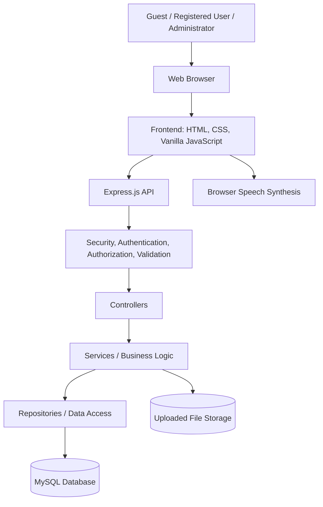
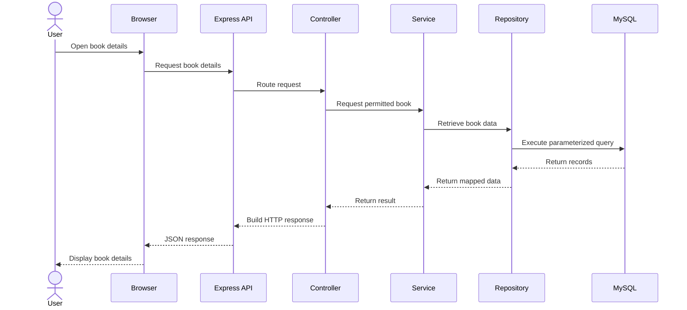
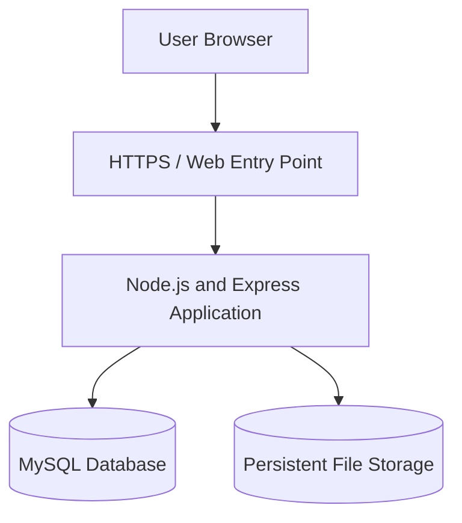

# Digital Library — System Architecture

**Project:** Digital Library  
**Document Version:** 1.0  
**Release Scope:** Version 1 (V1)  
**Status:** Active — Verify Against Implementation  
**Frontend:** HTML, CSS, Vanilla JavaScript  
**Backend:** Node.js, Express.js  
**Database:** MySQL  
**Architecture Style:** Monolithic, Layered Backend

---

## 1. Purpose

This document describes the system architecture of Digital Library, including its major components, responsibilities, communication paths, data flow, security boundaries, and deployment considerations.

The architecture is intended to guide implementation, testing, maintenance, and future development while preserving the approved technology stack and monolithic design.

The architecture described here is the intended design. Actual implementation details must be confirmed against the current source code.

---

## 2. Architectural Goals

The architecture aims to:

1. Keep the system understandable and suitable for a BTech final-year project.
2. Separate frontend, backend, and database responsibilities.
3. Keep business logic out of frontend code.
4. Centralize authorization and validation in the backend.
5. Protect private user documents.
6. Maintain consistent and reliable database operations.
7. Support testing and incremental development.
8. Minimize unnecessary dependencies and architectural complexity.
9. Preserve the approved technology stack.
10. Allow future features without requiring a complete redesign.

---

## 3. Architecture Decisions and Constraints

The approved technology stack is:

- HTML for page structure.
- CSS for presentation and responsive layouts.
- Vanilla JavaScript for frontend behavior.
- Node.js for the server runtime.
- Express.js for HTTP routing and middleware.
- MySQL for relational data persistence.

The application uses a **monolithic architecture**. Frontend assets, backend modules, and database access belong to one coordinated application rather than independently deployed microservices.

The backend may use a layered structure:

Route → Middleware → Controller → Service → Repository → MySQL

The exact layers used by each feature must match the actual codebase.

---

## 4. High-Level Architecture



**Diagram notes:**

- The browser renders the user interface and runs client-side JavaScript.
- The Express.js backend handles API requests and enforces server-side security.
- The database stores structured application records.
- File storage holds uploaded documents where the feature is implemented.
- Browser speech synthesis is a client-side capability and may vary across browsers.
- The diagram shows logical responsibilities, not a guarantee that every feature uses every component.

---

## 5. System Components

### 5.1 Frontend

The frontend is responsible for:

- Rendering application pages.
- Collecting user input.
- Sending API requests.
- Displaying catalogue results.
- Presenting book and chapter content.
- Managing reader controls and preferences.
- Showing validation errors and operation feedback.
- Handling loading and empty states.
- Supporting responsive layouts.
- Using browser speech features where supported.

The frontend must not be treated as a trusted security boundary.

It must not connect directly to MySQL or contain database credentials, JWT signing secrets, or other server-side secrets.

### 5.2 Backend

The backend is responsible for:

- Receiving HTTP requests.
- Parsing request bodies.
- Applying security middleware.
- Authenticating protected requests.
- Enforcing role and ownership permissions.
- Validating untrusted input.
- Applying business rules.
- Coordinating database operations.
- Managing supported file operations.
- Returning consistent responses.
- Handling unexpected errors safely.

### 5.3 Database

MySQL is responsible for structured persistent data, according to the approved schema.

Potential data groups include:

- User accounts.
- Books.
- Authors.
- Categories.
- Chapters.
- Book relationships.
- Publication and visibility information.
- Private PDF metadata.
- Other implemented application records.

The actual tables, columns, constraints, indexes, and relationships are defined by the database design and the current schema.

### 5.4 File Storage

File storage is responsible for retaining uploaded documents where supported.

The storage design must specify:

- Storage location.
- Filename handling.
- Ownership metadata.
- File-size limits.
- File validation.
- Retrieval permissions.
- Deletion behavior.
- Persistence and backup requirements.

The application must not expose private file paths or unrestricted access to private documents.

### 5.5 Browser Capabilities

The frontend may use browser-native features such as speech synthesis.

These features depend on browser and operating-system support. The application should handle unavailable capabilities without preventing ordinary reading.

---

## 6. Backend Layer Responsibilities

### 6.1 Routes

Routes define API paths and HTTP methods and connect requests to the relevant middleware and controllers.

Responsibilities:

- Register endpoints.
- Apply appropriate route-level middleware.
- Maintain clear resource boundaries.
- Avoid embedding substantial business logic in route definitions.

### 6.2 Middleware

Middleware handles cross-cutting request concerns.

Examples include:

- Authentication.
- Role-based authorization.
- Request parsing.
- Rate limiting.
- Security headers.
- CORS configuration.
- Validation integration.
- Error handling.

Middleware must be applied consistently with the requirements of each endpoint.

### 6.3 Controllers

Controllers coordinate HTTP request and response behavior.

Responsibilities:

- Read validated request data.
- Call the appropriate service.
- Select the appropriate HTTP status.
- Return the documented response structure.
- Forward errors to the established error-handling mechanism.

Controllers should not contain unnecessary database implementation details.

### 6.4 Services

Services implement application business rules.

Responsibilities may include:

- Coordinating book operations.
- Enforcing publication and visibility rules.
- Managing book relationships.
- Coordinating chapter operations.
- Applying ownership-related business rules.
- Coordinating supported file-processing workflows.

The service layer must not bypass authorization or validation requirements established by the application design.

### 6.5 Repositories

Repositories isolate database access where this layer is used.

Responsibilities:

- Execute database queries.
- Handle database result mapping.
- Support required filtering and pagination.
- Use safe parameterized operations.
- Respect schema constraints and transaction requirements.

Repositories should not independently grant user permissions.

### 6.6 Utilities and Validators

Utilities and validators provide reusable behavior.

Examples may include:

- Input validation.
- Identifier validation.
- File validation.
- Error helpers.
- Visibility helpers.
- Response helpers.

Shared utilities should have clear responsibilities and predictable behavior.

---

## 7. Request Processing Flow

A typical API request follows this sequence:

1. The user performs an action in the browser.
2. Frontend JavaScript creates an HTTP request.
3. Express.js receives the request.
4. Global middleware processes the request.
5. Route-specific middleware performs required authentication, authorization, or validation.
6. The controller handles the HTTP interaction.
7. The service applies business rules.
8. The repository accesses MySQL when needed.
9. The service processes the result.
10. The controller returns the documented response.
11. The frontend updates the interface.

Not every request requires every step. For example, a static frontend asset or a health endpoint may follow a simpler path.

---

## 8. Example Data Flow: Book Retrieval



The real route, method, response fields, and authorization behavior must be verified from the implementation.

---

## 9. Authentication and Authorization Architecture

Authentication establishes the identity of a requester. Authorization determines what that identity may do.

The documented roles are:

- `USER`
- `ADMIN`

The backend must enforce access rules independently of the frontend.

### 9.1 Authentication Flow

The intended flow is:

1. The client submits credentials.
2. The backend validates the request.
3. The backend verifies the stored password hash.
4. The backend establishes authentication using the configured mechanism.
5. The client uses the authenticated state for protected operations.
6. The backend verifies authentication on protected requests.
7. Logout follows the implemented invalidation or session-clearing behavior.

The actual use of JWTs, HttpOnly cookies, bearer tokens, or server-side session state must be confirmed from the authentication implementation.

### 9.2 Authorization Flow

For a protected operation:

1. The backend identifies the requester.
2. The backend verifies the required role or permission.
3. The backend checks resource ownership where applicable.
4. The backend evaluates the operation's business rules.
5. The backend permits or rejects the operation.

### 9.3 Private Resource Isolation

Private PDFs must be protected by server-side ownership checks.

Knowing a resource identifier must not be sufficient to access another user's document.

Administrative permissions must follow the explicit authorization design rather than an assumption of universal private-resource access.

---

## 10. Database Architecture

The application uses MySQL as its relational database.

The database design must specify:

- Tables and columns.
- Primary keys.
- Foreign keys.
- Uniqueness rules.
- Required and optional fields.
- Data types.
- Referential actions.
- Indexes.
- Transaction boundaries where needed.

### 10.1 Data Access

All application database operations must pass through the backend.

The frontend must not connect directly to MySQL.

### 10.2 Data Integrity

The system should use database constraints and application validation together.

Application validation provides meaningful error handling, while database constraints protect data integrity at the persistence boundary.

### 10.3 Transactions

Operations that must succeed or fail as a unit should use database transactions where supported and appropriate.

The exact transactional boundaries depend on the implemented workflows and schema.

---

## 11. File Processing Architecture

Where PDF upload and processing are implemented, the expected logical flow is:

1. The authenticated user submits a file.
2. The backend verifies authorization.
3. The backend validates the file and configured size limits.
4. The backend processes the document according to the supported workflow.
5. The application stores the required file and metadata.
6. The application associates the resource with the correct owner.
7. The API returns the appropriate result.

Failure handling must account for invalid files, processing errors, and storage failures.

The application must not expose a document as successfully stored when the required operation has failed.

The exact processing library, extraction behavior, and storage strategy must be confirmed from the current implementation.

---

## 12. Error-Handling Architecture

The backend should use a consistent error-handling approach.

Relevant error categories include:

- Validation errors.
- Authentication failures.
- Authorization failures.
- Missing resources.
- Duplicate or conflicting records.
- Database errors.
- File-processing errors.
- Rate-limit errors.
- Unexpected internal errors.

Production responses must not disclose sensitive stack traces, database credentials, tokens, or environment secrets.

The frontend should display useful messages without exposing internal implementation details.

---

## 13. Security Architecture

Security controls should be applied at the relevant system boundaries.

### 13.1 Frontend Security

- Avoid embedding server secrets in frontend assets.
- Render user-controlled content safely.
- Use HTTPS in public deployment.
- Handle authentication state consistently.
- Display clear errors without exposing sensitive information.

### 13.2 Backend Security

- Validate untrusted input.
- Authenticate protected requests.
- Enforce role and ownership checks.
- Use parameterized SQL.
- Hash passwords securely.
- Apply appropriate rate limiting.
- Configure security headers.
- Restrict CORS to required origins.
- Handle errors safely.
- Validate uploaded files.
- Protect private resources.

### 13.3 Configuration Security

Secrets must be supplied through environment configuration or an appropriate deployment secret mechanism.

Environment files containing real credentials must not be committed to source control.

Security configuration must be checked in the actual deployment environment.

---

## 14. Frontend Architecture

The frontend uses HTML, CSS, and Vanilla JavaScript.

A conceptual structure is:

```text
frontend/
├── index.html
├── pages/
├── css/
├── js/
│   ├── api/
│   ├── components/
│   ├── pages/
│   ├── reader/
│   └── utils/
└── assets/
```

This is an illustrative organization, not a requirement to create every listed file or folder.

The actual frontend structure should be documented after reviewing the existing repository.

### 14.1 Frontend Responsibilities

- Display pages and components.
- Manage user interactions.
- Call backend APIs.
- Display returned data.
- Handle loading, success, and error states.
- Manage supported reader preferences.
- Use browser-native speech features where supported.

### 14.2 API Client

Shared frontend API logic may centralize:

- Base URL configuration.
- HTTP request handling.
- JSON parsing.
- Authentication-related request configuration.
- Error normalization.
- Reusable request helpers.

The API client must follow the backend's actual authentication and response contracts.

---

## 15. Repository Organization

The project is intended to retain a clear separation between application code, database artifacts, tests, and documentation.

Conceptual project structure:

```text
digital-library/
├── frontend/
├── backend/
│   └── src/
│       ├── routes/
│       ├── controllers/
│       ├── services/
│       ├── repositories/
│       ├── middleware/
│       ├── validators/
│       ├── utils/
│       └── config/
├── database/
├── tests/
├── docs/
├── uploads/
└── README.md
```

The exact folder names and files must reflect the current repository. This diagram does not instruct developers to relocate existing files without reviewing their dependencies.

The `uploads/` directory must be configured and protected appropriately if it is used for private files. Private documents must not become publicly accessible merely because they reside in a project directory.

---

## 16. Configuration and Environment Management

The application may require configuration values such as:

- Application port.
- Runtime environment.
- MySQL host.
- MySQL port.
- MySQL database name.
- MySQL username.
- MySQL password.
- Authentication secret or key.
- Frontend origin or allowed CORS origins.
- File-upload limits.
- File-storage path.

These names are illustrative. The actual names must match the project's environment validation and configuration code.

Requirements:

1. Required configuration must be validated during startup.
2. Missing required values must produce an appropriate startup failure.
3. Real secrets must not be committed to source control.
4. Development and production configuration must be separated.
5. Production cookie, HTTPS, and CORS settings must be reviewed.
6. Configuration values must not be returned through public endpoints.

---

## 17. Deployment Architecture

The application may be deployed using a compatible Node.js hosting environment and a MySQL database service.

A conceptual production arrangement is:



The actual hosting provider, reverse proxy, database placement, file-storage service, and network topology must be documented after a deployment approach is selected.

### 17.1 Deployment Requirements

- Use HTTPS for public access.
- Keep credentials outside source code.
- Restrict database access to required application connections.
- Configure persistent storage for required uploaded files.
- Apply appropriate CORS and cookie settings.
- Verify application startup and database connectivity.
- Test core workflows after deployment.
- Maintain a backup and recovery procedure before public production release.

---

## 18. Testing Architecture

Testing should cover the application's major layers and integration boundaries.

### 18.1 Unit Testing

Test isolated business rules, validators, and utilities where unit tests are implemented.

### 18.2 API Testing

Test HTTP routes, request validation, status codes, response structures, and authorization.

### 18.3 Database Integration Testing

Test database queries, relationships, constraints, and relevant transactions.

### 18.4 Security Testing

Test invalid authentication, unauthorized roles, cross-user resource access, unsafe inputs, and upload restrictions.

### 18.5 Frontend Testing

Test navigation, forms, API integration, reader controls, responsive layouts, and error states.

### 18.6 Deployment Testing

Verify the deployed configuration, connectivity, authentication, core operations, and file access restrictions.

Test results must reflect actual execution evidence. A planned test must not be recorded as passed until it has been run.

---

## 19. Scalability and Performance Considerations

The initial architecture is designed for the project's V1 scope and academic requirements.

Potential improvements, if justified by measured needs, include:

- Appropriate database indexes.
- Query optimization.
- Pagination.
- Efficient frontend rendering.
- File-size and resource limits.
- Improved logging and monitoring.
- More efficient file storage.
- Caching where appropriate and safe.

These improvements must not introduce unnecessary complexity without a documented reason.

The project does not require microservices to achieve its initial architectural goals.

---

## 20. Known Architectural Considerations

The following areas require ongoing review:

1. Actual route and middleware organization.
2. Authentication and logout lifecycle.
3. In-memory token revocation behavior, if used.
4. Private PDF storage and access-control enforcement.
5. Consistency between service and repository responsibilities.
6. Transaction handling for related database changes.
7. Error-response consistency.
8. Frontend structure and API client behavior.
9. Deployment-specific cookie and CORS configuration.
10. Persistent storage and backup of uploaded documents.

These are review items, not proof that the implementation has a defect.

---

## 21. Future Architecture Extensions

Future features may include:

- AI-assisted semantic search.
- AI-based book recommendations.
- Chapter translation.
- OCR for scanned PDFs.
- A more persistent token-revocation or refresh-token design.
- Enhanced reading and personalization features.

Each extension must be reviewed for security, privacy, performance, cost, maintainability, and compatibility with the approved monolithic architecture.

Future scope must not be treated as implemented V1 functionality.

---

## 22. Architecture Verification Checklist

- [ ] Confirm the actual frontend structure.
- [ ] Confirm the backend startup and route-registration process.
- [ ] Confirm route, controller, service, and repository responsibilities.
- [ ] Confirm authentication middleware and token lifecycle.
- [ ] Confirm role-based authorization.
- [ ] Confirm private-resource ownership checks.
- [ ] Confirm MySQL schema and relationships.
- [ ] Confirm file storage and processing behavior.
- [ ] Confirm environment-variable names and validation.
- [ ] Confirm error-handling middleware.
- [ ] Confirm CORS, security headers, and rate limiting.
- [ ] Confirm the actual deployment topology.
- [ ] Confirm test coverage and current test results.
- [ ] Update architecture diagrams to match verified implementation.

---

## 23. Related Documents

- `docs/01-product/PRD.md`
- `docs/01-product/feature-list.md`
- `docs/02-requirements/SRS.md`
- `docs/02-requirements/functional-requirements.md`
- `docs/02-requirements/non-functional-requirements.md`
- `docs/02-requirements/acceptance-criteria.md`
- `docs/02-requirements/use-cases.md`
- `docs/03-technical/api-specification.md`
- `docs/03-technical/database-design.md`
- `docs/03-technical/integration-design.md`
- `docs/03-technical/technology-stack.md`
- `docs/03-technical/TRD.md`
- `docs/05-security/`
- `docs/06-development/`
- `docs/07-testing/`
- `docs/08-deployment/`

---

## 24. Document Maintenance

Review this architecture whenever:

- The system's component boundaries change.
- The backend layer responsibilities change.
- The database schema changes materially.
- Authentication or authorization behavior changes.
- File storage or processing changes.
- A new integration is introduced.
- Deployment topology changes.
- A new release adds substantial capabilities.

Document the rationale for approved architectural changes and keep related technical documentation consistent.

---

## 25. Conclusion

Digital Library uses an intentionally straightforward monolithic architecture built around HTML, CSS, Vanilla JavaScript, Node.js, Express.js, and MySQL.

The architecture separates user-interface responsibilities from backend business rules and persistent data access while emphasizing security, maintainability, and testability.

The current source code and verified runtime behavior remain the authoritative basis for confirming that the architecture is implemented as described.
