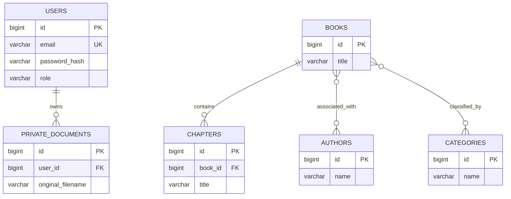

# Digital Library — Database Design

**Project:** Digital Library  
**Document Version:** 1.0  
**Release Scope:** Version 1 (V1)  
**Status:** Active — Verify Against Actual Schema  
**Database:** MySQL  
**Backend:** Node.js and Express.js  
**Architecture:** Monolithic Application

---

## 1. Purpose

This document describes the database design principles, entities, relationships, integrity constraints, indexing strategy, and data-access requirements for the Digital Library application.

The database must support user authentication, book catalogue management, authors, categories, chapters, book relationships, and private PDF records where implemented.

This is a design specification. Actual table names, column names, data types, constraints, and relationships must be confirmed against the current SQL schema and database migrations. Do not treat illustrative schemas in this document as proof of the existing database structure.

---

## 2. Database Design Objectives

The database design aims to:

1. Store application data consistently.
2. Maintain referential integrity.
3. Prevent duplicate records where uniqueness is required.
4. Support secure user authentication.
5. Protect private user-owned documents.
6. Support efficient catalogue queries.
7. Reduce unnecessary data duplication.
8. Support appropriate transaction boundaries.
9. Provide a maintainable relational structure.
10. Align the database with the application's functional requirements.

---

## 3. Database Technology

**Database management system:** MySQL

The backend communicates with MySQL through its configured database access layer.

Database credentials must remain server-side and must be supplied through environment configuration.

The exact MySQL version, storage engine, character set, collation, and connection-pool configuration must be recorded from the actual environment.

### 3.1 Database Naming

Use the database name configured for the current environment.

Avoid hardcoding environment-specific database names in application logic.

Development, testing, and production environments should use appropriately separated database configurations.

---

## 4. Logical Data Model

The principal logical entities are:

- Users
- Books
- Authors
- Categories
- Chapters
- Book-author relationships, if modeled separately
- Book-category relationships, if modeled separately
- Private PDF documents, where implemented

Additional tables may exist for authentication state, token revocation, preferences, or other implemented functionality.

The exact entity model must follow the actual database schema.

---

## 5. Entity Relationship Diagram

The following diagram shows a conceptual relationship model. It does not establish the actual table names or cardinalities in the existing database.

**Important:** The identifiers and fields above are illustrative. Use the actual primary keys, foreign keys, column types, and relationship cardinalities from the existing schema. If the implementation uses different relationships or tables, update this diagram accordingly.

---

## 6. Users Entity

The users entity stores account information required for authentication and authorization.

Potential attributes include:

| Attribute | Purpose | Design consideration |
|---|---|---|
| User identifier | Uniquely identifies the account | Primary key |
| Email or username | Identifies the account during login | Uniqueness according to authentication rules |
| Password hash | Stores the securely hashed password | Never store plaintext passwords |
| Role | Represents application permissions | Validate allowed role values |
| Created timestamp | Records account creation time | Use a consistent time convention |
| Updated timestamp | Records the latest update, if supported | Maintain consistently |

The actual column names and data types must match the implementation.

### 6.1 User Constraints

- The primary key must uniquely identify each account.
- Login identifiers must follow the configured uniqueness rules.
- Passwords must be hashed using the approved password-hashing mechanism.
- Role values must be validated.
- User-controlled input must be validated before persistence.
- Sensitive account fields must not be exposed unnecessarily through API responses.

### 6.2 Role Management

The documented application roles are:

- `USER`
- `ADMIN`

The backend must not trust a client-submitted role when creating or modifying an account unless the operation is explicitly authorized by a secure administrative workflow.

---

## 7. Books Entity

The books entity stores metadata about library books.

Potential attributes include:

- Book identifier.
- Title.
- Description.
- Publication or visibility state.
- Author relationship information.
- Category relationship information.
- Created and updated timestamps.
- Other metadata required by the implemented features.

These are logical attributes, not confirmed column names.

### 7.1 Book Constraints

- Every book must have a valid primary key.
- Required metadata must be validated.
- Related author and category references must follow the actual schema.
- Publication and visibility values must follow the documented business rules.
- Queries must respect the access rules for public and restricted content.

### 7.2 Book Visibility

The database may store publication or visibility information if supported by the implementation.

The backend must enforce visibility rules when retrieving books and related chapters.

Changing a frontend display flag must not grant access to restricted content.

---

## 8. Authors Entity

The authors entity stores author information associated with books.

Potential attributes include:

- Author identifier.
- Author name.
- Biography or other metadata, if supported.
- Timestamps, if implemented.

### 8.1 Author Relationships

A book may have one or more authors, and an author may be associated with multiple books.

If the implementation models this many-to-many relationship, it should use a junction table with appropriate foreign keys and uniqueness constraints.

If the actual application uses a different model, document that model instead.

### 8.2 Author Integrity

- Author identifiers must be unique.
- Required author fields must be validated.
- Relationships must reference existing records.
- Deletion must follow the configured referential-integrity rules.

---

## 9. Categories Entity

The categories entity organizes books into categories.

Examples of possible categories include:

- Science
- Mathematics
- Psychology
- History

These examples do not require that all categories be preloaded into the database.

### 9.1 Category Attributes

Potential attributes include:

- Category identifier.
- Category name.
- Description, if supported.
- Timestamps, if implemented.

### 9.2 Category Constraints

- Category identifiers must be unique.
- Category names should follow the approved uniqueness policy.
- Invalid category references must be rejected.
- Category deletion must respect associated book relationships.

### 9.3 Book-Category Relationship

If books can belong to multiple categories, a junction table can represent the many-to-many relationship.

The junction table should have foreign keys to the book and category records and should prevent duplicate pairs.

The actual relationship cardinality must be confirmed from the existing schema.

---

## 10. Chapters Entity

The chapters entity stores reading sections associated with books.

Potential attributes include:

- Chapter identifier.
- Parent book identifier.
- Chapter title.
- Chapter content or content reference.
- Chapter ordering information, if supported.
- Visibility information, if implemented.
- Timestamps, if implemented.

### 10.1 Chapter Constraints

- Each chapter must reference a valid parent book where the schema requires it.
- Required chapter data must be validated.
- Chapter ordering must follow the implemented rules.
- Retrieval must respect the parent's visibility and access rules.
- Deletion must follow the database and business-rule design.

### 10.2 Chapter Content

The storage strategy for chapter content must be confirmed from the actual implementation.

Content may be stored directly in the database or represented through another supported mechanism. Do not assume a particular storage format without checking the schema and application code.

---

## 11. Private PDF Documents

If the private PDF library is implemented, the database should maintain the metadata required to identify each document and its owner.

Potential metadata includes:

- Document identifier.
- Owning user identifier.
- Original filename.
- Stored filename or storage reference.
- File size.
- Media type.
- Processing status, if supported.
- Created timestamp.
- Other metadata required by the implemented workflow.

### 11.1 Ownership

Each private document must be associated with the correct owner.

The backend must verify ownership before returning or modifying a private resource.

A document identifier must not function as an authorization mechanism.

### 11.2 File Storage Separation

Binary PDF content may be stored in a file-storage system while metadata is stored in MySQL.

The actual implementation determines whether files are stored on disk, in external object storage, in the database, or through another mechanism.

The database record and physical file must remain consistent according to the implemented storage design.

### 11.3 Deletion Consistency

If a document is deleted, the system must follow a defined policy for its metadata and physical file.

Failure handling must prevent the application from reporting complete deletion when the required cleanup has failed.

---

## 12. Relationships and Junction Tables

Many-to-many relationships are commonly represented by junction tables.

For example, a conceptual book-author junction table may contain:

- Book identifier.
- Author identifier.
- Optional relationship metadata if required.

A conceptual book-category junction table may contain:

- Book identifier.
- Category identifier.

These are design examples only. Do not create new junction tables if the current schema already represents the relationships differently.

### 12.1 Junction Table Constraints

Where applicable:

- Each reference must point to an existing record.
- A composite primary key or unique constraint should prevent duplicate relationship pairs.
- Indexes should support common relationship queries.
- Delete and update rules must be explicitly selected.
- Multi-step relationship updates should preserve consistency.

---

## 13. Primary Keys

Every persistent entity should have a stable primary key.

Primary keys must:

- Uniquely identify records.
- Be non-null.
- Remain stable during ordinary updates.
- Use a data type suitable for the expected identifier range.

The actual project schema may use integer, UUID, or another identifier format. Document the existing choice rather than changing it without a migration plan.

---

## 14. Foreign Keys and Referential Integrity

Foreign keys should be used where appropriate to preserve relationships between records.

Potential relationships include:

- Chapters to books.
- Book-author junction records to books and authors.
- Book-category junction records to books and categories.
- Private documents to users.

### 14.1 Referential Actions

For each foreign key, determine the appropriate behavior when a referenced record is updated or deleted.

Possible actions include:

- `RESTRICT`
- `CASCADE`
- `SET NULL`

The selected behavior must match the business rules and actual schema.

Do not apply cascading deletion automatically where it could remove important content or private files unexpectedly.

### 14.2 Application-Level Validation

Application validation should check references and provide useful errors.

Database foreign keys should provide an additional integrity boundary where supported.

Application checks alone should not be assumed to guarantee database consistency under concurrent requests.

---

## 15. Normalization

The schema should be reviewed for the first three normal forms where applicable.

### 15.1 First Normal Form (1NF)

A table should contain values appropriate to the declared columns, with no repeating groups represented as multiple values in a single field when those values need to be independently managed.

Examples:

- Store separate authors as related records when the application needs to manage them independently.
- Represent book-category associations through an appropriate relationship model.
- Avoid storing multiple independent category identifiers in a single text field.

### 15.2 Second Normal Form (2NF)

A table should satisfy 1NF and every non-key attribute should depend on the whole candidate key.

This consideration is particularly relevant to junction tables with composite keys.

Relationship-specific attributes should depend on the complete relationship key.

### 15.3 Third Normal Form (3NF)

A table should satisfy 2NF and avoid inappropriate transitive dependencies between non-key attributes.

Examples:

- Store author information in the author entity rather than repeatedly copying it into each book record.
- Store category information in the category entity rather than duplicating category descriptions in every relationship row.

### 15.4 Normalization Verification

Normalization must be evaluated against the actual schema and functional dependencies.

Do not claim the schema is in 3NF until its table definitions and dependencies have been reviewed.

---

## 16. Unique Constraints

Unique constraints should protect values that must not be duplicated.

Potential examples include:

- Login identifiers, according to authentication rules.
- Category names, if the business rules require uniqueness.
- Relationship pairs in junction tables.
- Other natural keys identified by the schema.

Uniqueness requirements must be defined explicitly, including case sensitivity and normalization behavior where relevant.

Application-level duplicate checks should not replace database uniqueness constraints where a database constraint is appropriate.

---

## 17. Indexing Strategy

Indexes should support common query patterns without adding unnecessary write overhead.

Potential index targets include:

- User login identifiers.
- Book titles or other supported catalogue search fields.
- Foreign keys.
- Chapter parent-book identifiers.
- Relationship junction keys.
- Private document owner identifiers.
- Frequently used filtering and ordering fields.

These are candidates, not a list of confirmed existing indexes.

### 17.1 Indexing Principles

1. Index primary keys and required unique keys through the schema's appropriate constraints.
2. Ensure common relationship lookups have suitable indexes.
3. Evaluate indexes for frequently used filters and sort operations.
4. Consider composite indexes for queries that filter on multiple fields.
5. Avoid redundant indexes.
6. Review query plans and representative performance measurements before adding indexes.
7. Reassess indexes when query patterns change.

### 17.2 Index Verification

Use the actual MySQL schema and query plans to confirm the index strategy.

Do not add indexes solely because a column appears in this document.

---

## 18. Data Types and Column Design

Column data types should match the values stored and the operations performed.

Considerations include:

- Appropriate numeric types for identifiers.
- Sufficient text lengths for metadata.
- Suitable text types for supported content.
- Date and timestamp types for temporal data.
- Appropriate storage for status values.
- Correct nullability.
- Character set and collation.
- Storage limits for large content.

The actual data types must be confirmed from the schema.

Avoid storing structured values as free-form text when the application requires relational integrity or independent querying.

---

## 19. Transactions and Atomicity

Operations that modify multiple related records may require transactions.

Examples may include:

- Creating a book with relationship records.
- Updating multiple related associations.
- Updating metadata alongside a file-processing state.
- Deleting a resource and updating dependent records.

The exact transactional requirements depend on the implemented operations.

Where a workflow requires all-or-nothing behavior, use a suitable transaction strategy and handle rollback correctly.

File-system operations and MySQL transactions do not automatically form one atomic transaction. File cleanup and database changes therefore require explicit failure-handling design.

---

## 20. Concurrency and Consistency

The database design must account for concurrent requests that may update the same records.

Requirements:

- Use database constraints to protect unique values.
- Avoid relying only on prior application checks for concurrent uniqueness-sensitive operations.
- Use transactions for operations that require atomicity.
- Handle database conflict errors appropriately.
- Avoid reporting success when a conflicting update has failed.

Additional locking or concurrency-control mechanisms should be introduced only where required by the actual workflows.

---

## 21. Database Security

### 21.1 Credentials

Database credentials must be stored outside frontend code and must not be committed to source control.

### 21.2 SQL Injection Prevention

User-controlled values must be passed through parameterized SQL queries or equivalent safe database operations.

Do not construct SQL by concatenating untrusted input into query strings.

### 21.3 Least Privilege

The application's database account should receive only the permissions needed for its operation.

Development and administrative database credentials should not automatically be used by a public production application.

### 21.4 Sensitive Data

Passwords must be stored as approved password hashes.

Private document metadata and user records must be accessible only through authorized application operations.

### 21.5 Error Handling

Database error details must be logged appropriately without exposing credentials, connection strings, or sensitive internal information to clients.

---

## 22. Database Migrations and Schema Changes

Schema changes must be controlled and repeatable.

For each schema change:

1. Identify affected tables and relationships.
2. Document the reason for the change.
3. Prepare a migration or controlled schema-update procedure.
4. Review data preservation and rollback considerations.
5. Update application queries and validation where necessary.
6. Run relevant database and API tests.
7. Update this document and related documentation.

Do not modify production schema manually without a documented change procedure.

The actual project may use SQL scripts or a migration tool. Document the mechanism already adopted by the repository.

---

## 23. Backup and Recovery

Before public production deployment, the project must define:

- Database backup frequency.
- Backup storage location.
- Backup access controls.
- Retention policy.
- Restore procedure.
- Protection of uploaded files.
- Verification of backup integrity.
- Recovery testing.

Database backups alone may be insufficient if uploaded PDFs are stored separately.

The database and file-storage backup procedures must account for consistency between document metadata and physical files.

Specific recovery-time and recovery-point targets must be established separately if required.

---

## 24. Database Testing

Database testing should include:

### 24.1 Schema Tests

- Verify required tables and columns.
- Verify primary keys.
- Verify foreign keys.
- Verify uniqueness constraints.
- Verify nullability and data types.
- Verify indexes.

### 24.2 Integrity Tests

- Attempt invalid foreign-key references.
- Test duplicate values.
- Test deletion behavior for referenced records.
- Test relationship creation and removal.
- Test transaction rollback where applicable.

### 24.3 Security Tests

- Confirm parameterized database operations.
- Confirm restricted database permissions.
- Confirm credentials are not exposed.
- Confirm private document ownership enforcement through the API.

### 24.4 Integration Tests

- Test backend-to-MySQL connectivity.
- Test representative CRUD operations.
- Test error handling when the database is unavailable.
- Test persistence after a controlled restart.

Test outcomes must reflect actual execution evidence.

---

## 25. Schema Verification Checklist

- [ ] Compare documented tables with the actual MySQL schema.
- [ ] Confirm primary keys and identifier formats.
- [ ] Confirm all foreign keys and relationship cardinalities.
- [ ] Confirm unique constraints.
- [ ] Confirm nullability and column data types.
- [ ] Confirm referential actions.
- [ ] Review normalization and functional dependencies.
- [ ] Review indexes against real query patterns.
- [ ] Confirm private-document ownership representation.
- [ ] Confirm file-storage metadata and deletion behavior.
- [ ] Review transaction boundaries.
- [ ] Confirm database credential handling.
- [ ] Confirm backup and recovery procedures.
- [ ] Run schema and integration tests.
- [ ] Update diagrams to match the verified schema.

---

## 26. Related Documents

- `docs/02-requirements/SRS.md`
- `docs/02-requirements/functional-requirements.md`
- `docs/02-requirements/non-functional-requirements.md`
- `docs/02-requirements/acceptance-criteria.md`
- `docs/03-technical/architecture.md`
- `docs/03-technical/api-specification.md`
- `docs/03-technical/integration-design.md`
- `docs/03-technical/technology-stack.md`
- `docs/03-technical/TRD.md`
- `docs/05-security/`
- `docs/07-testing/`
- `docs/08-deployment/`

---

## 27. Document Maintenance

Review this document whenever:

- Tables or columns change.
- Relationships are added or removed.
- Authentication or user roles change.
- Private PDF storage changes.
- Query patterns or indexing strategy change.
- New constraints are introduced.
- Data retention or backup requirements change.
- A release changes the data model.

Keep the documented schema aligned with SQL files, migrations, repository queries, and the deployed database.

---

## 28. Conclusion

The Digital Library database must support the application's catalogue, account, relationship, chapter, and private-document workflows while maintaining integrity, security, and maintainability.

This document defines the design principles and verification expectations. The actual schema and tested application behavior remain authoritative for confirming the implemented database structure.
