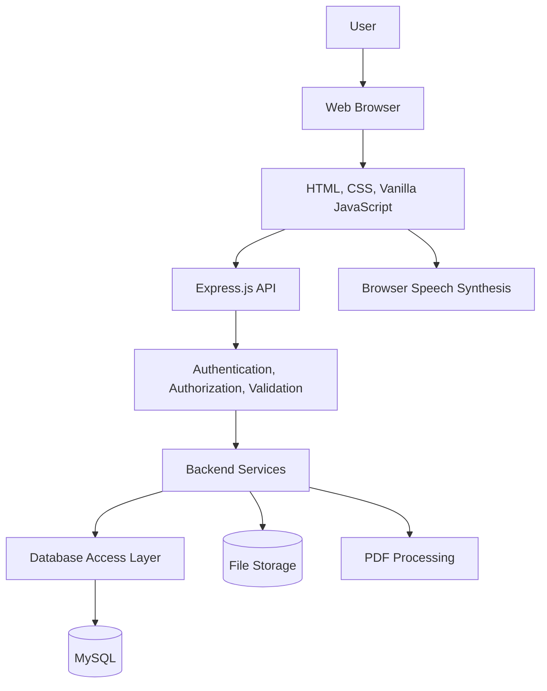

# Digital Library — Integration Design

**Project:** Digital Library  
**Document Version:** 1.0  
**Release Scope:** Version 1 (V1)  
**Status:** Active — Verify Against Implementation  
**Frontend:** HTML, CSS, Vanilla JavaScript  
**Backend:** Node.js, Express.js  
**Database:** MySQL  
**Architecture:** Monolithic Application

---

## 1. Purpose

This document describes how the Digital Library components communicate and integrate with one another.

It covers frontend-to-backend communication, backend-to-database access, authentication, file processing, browser capabilities, error handling, configuration, and integration testing.

The design follows the approved monolithic architecture. It does not introduce microservices.

The documented integration patterns must be compared with the actual source code before being treated as implemented behavior.

---

## 2. Integration Objectives

The integration design aims to:

1. Define clear boundaries between the frontend, backend, database, and file storage.
2. Establish consistent API communication.
3. Protect authenticated and private resources.
4. Preserve database integrity.
5. Handle failures predictably.
6. Support manual and automated integration testing.
7. Keep configuration secure.
8. Minimize unnecessary dependencies.
9. Maintain compatibility with the approved technology stack.
10. Allow future enhancements without destabilizing V1 functionality.

---

## 3. Integrated Components

| Component | Technology | Responsibility |
|---|---|---|
| Frontend | HTML, CSS, Vanilla JavaScript | User interface and browser-side behavior |
| Backend | Node.js, Express.js | API handling and business logic |
| Database | MySQL | Structured data persistence |
| Authentication | Existing backend authentication implementation | Establishing and validating authenticated requests |
| File storage | Actual configured storage mechanism | Persisting uploaded files where supported |
| PDF processing | Existing PDF-processing implementation | Handling supported PDF workflows |
| Browser speech | Browser Speech Synthesis API, where supported | Reading supported content aloud |
| Source control | Git | Tracking source and documentation changes |

The table identifies the intended integration boundaries. It does not establish that every optional feature is currently implemented.

---

## 4. High-Level Integration Architecture

The diagram represents logical integration paths. The actual source code determines the exact execution sequence and which layers each feature uses.

---

## 5. Frontend-to-Backend Integration

### 5.1 Communication Method

The frontend communicates with the backend through HTTP requests to the configured API base URL.

JSON is the expected format for ordinary structured requests and responses. File uploads and streamed documents may require different content types.

### 5.2 Responsibilities of the Frontend

The frontend should:

- Collect user input.
- Submit requests to the correct endpoints.
- Send the expected request fields.
- Handle successful responses.
- Display validation and operation errors.
- Show loading and empty states where appropriate.
- Avoid exposing server-side secrets.
- Avoid treating client-side permission checks as security enforcement.

### 5.3 Responsibilities of the Backend

The backend must:

- Validate incoming requests.
- Authenticate protected operations.
- Enforce role and ownership permissions.
- Apply business rules.
- Perform database and file operations as required.
- Return responses that match the documented API contract.
- Handle unexpected failures safely.

### 5.4 Shared API Client

A shared frontend API helper may centralize:

- API base URL configuration.
- HTTP request creation.
- JSON serialization and parsing.
- Authentication-related request settings.
- Error handling.
- Reusable request functions.

The implementation must follow the actual backend authentication mechanism and response format.

---

## 6. API Contract Integration

Frontend and backend changes must remain compatible.

For each endpoint, document:

- HTTP method.
- Route path.
- Authentication requirement.
- Required role or permission.
- Request content type.
- Request fields.
- Validation rules.
- Success status and response structure.
- Error status and response structure.
- Database or file side effects.

The actual Express route definitions, validators, controllers, and tests are the source of truth for these details.

### 6.1 Contract Consistency

When an API contract changes:

1. Identify affected frontend calls.
2. Identify affected routes, controllers, services, and repositories.
3. Update validation and authorization as required.
4. Update relevant tests.
5. Update API documentation.
6. Verify successful and failure paths.

A frontend change must not silently assume a new backend field or response format that has not been implemented.

---

## 7. Authentication Integration

Authentication integration must follow the mechanism implemented by the backend.

The project documentation describes token-based authentication and HttpOnly cookies, but the precise mechanism must be confirmed from the current authentication code.

### 7.1 Authentication Flow

1. The user submits credentials through the frontend.
2. The backend validates the request.
3. The backend verifies the credentials.
4. The backend establishes the configured authenticated state.
5. The frontend follows the documented response and authentication behavior.
6. Protected requests include authentication in the manner expected by the backend.
7. The backend verifies the authentication before executing protected operations.
8. Logout follows the implemented invalidation or session-clearing strategy.

### 7.2 Cookie-Based Integration

If authentication uses cookies:

- Configure the cookie with appropriate security attributes.
- Use HTTPS in public production environments.
- Configure frontend and backend origins correctly.
- Set credential-related request options when required.
- Configure CORS consistently with the cookie arrangement.
- Review CSRF protection for state-changing requests.

The exact settings must match the deployment architecture.

### 7.3 Token-Based Integration

If bearer tokens are used:

- Send tokens only through the approved authentication mechanism.
- Never place secrets in URLs.
- Avoid exposing tokens in logs.
- Handle expired or invalid tokens according to the API contract.
- Follow the implemented logout and revocation behavior.

Do not assume that bearer-token authentication and cookie authentication are both supported unless the code confirms this.

---

## 8. Role and Ownership Integration

The documented roles are `USER` and `ADMIN`.

The frontend may adapt its interface to the authenticated user's role, but the backend must independently enforce all permissions.

### 8.1 Administrative Operations

Operations such as book, author, category, chapter, and relationship management must enforce the configured administrative or resource-specific permissions.

### 8.2 Private Resources

Private PDF operations must enforce ownership or explicitly granted access.

The backend must not rely solely on a document identifier, hidden interface control, or frontend navigation restriction to protect private data.

### 8.3 Integration Tests

Test access with:

- An unauthenticated request.
- An authenticated USER.
- An authenticated ADMIN.
- A user attempting to access another user's private resource.

The exact expected outcome must follow the implemented permission matrix.

---

## 9. Backend-to-Database Integration

### 9.1 Database Connectivity

The backend connects to MySQL through its configured database connection mechanism.

The integration must use:

- Valid connection configuration.
- Appropriate connection handling.
- Safe query execution.
- Suitable error handling.
- Appropriate resource cleanup.

The actual connection library and pooling configuration must be confirmed from the repository.

### 9.2 Query Safety

All user-controlled query values must be handled using parameterized SQL operations or equivalent safe database APIs.

Untrusted values must not be concatenated directly into executable SQL.

### 9.3 Data Integrity

Database operations must respect:

- Primary keys.
- Foreign keys.
- Unique constraints.
- Required fields.
- Referential actions.
- Business rules.
- Transaction boundaries where required.

### 9.4 Database Failure Handling

If MySQL is unavailable or an operation fails:

1. The backend must not falsely report success.
2. The error must be handled by the established error-handling mechanism.
3. Client responses must not reveal database credentials or sensitive internals.
4. Operations involving multiple records must preserve their required consistency.

---

## 10. Integration of Books, Authors, Categories, and Chapters

The backend coordinates catalogue data and relationships.

### 10.1 Book Integration

Book operations may require interaction with:

- Book metadata.
- Author associations.
- Category associations.
- Chapter records.
- Publication or visibility state.

The actual relationships depend on the existing database schema.

### 10.2 Author Integration

Author-management operations must preserve the configured relationship between authors and books.

Deletion and update behavior must match the database constraints and application rules.

### 10.3 Category Integration

Category operations must maintain valid book-category associations and follow the configured deletion rules.

### 10.4 Chapter Integration

Chapter operations must reference valid parent books where required.

Content retrieval must respect the parent book's access and visibility rules.

### 10.5 Relationship Operations

Where a single workflow updates multiple related records, the implementation must define how partial failure is handled.

Use transactions when all related database changes must succeed or fail together.

---

## 11. File Upload Integration

Where private PDF upload is implemented, the frontend, backend, database, and file storage must work together.

### 11.1 Upload Flow

1. The user selects a file.
2. The frontend submits the file using the endpoint's expected request format.
3. The backend authenticates the user.
4. The backend checks the user's permission.
5. The backend validates file type, size, and applicable constraints.
6. The backend processes or stores the file according to the implemented workflow.
7. The backend persists the required metadata.
8. The resource is associated with the correct owner.
9. The API returns the operation result.

### 11.2 Upload Failure Cases

The integration must account for:

- Missing file.
- Unsupported file type.
- Oversized file.
- Malformed PDF.
- Processing failure.
- Storage failure.
- Database failure.
- Unauthorized request.
- Interrupted request.

The system must not report a complete upload when the required storage and metadata operations have failed.

### 11.3 File and Database Consistency

The filesystem and MySQL do not automatically share a single transaction.

The application must define safe cleanup and recovery behavior for situations where a file operation succeeds but the corresponding database operation fails, or vice versa.

The precise solution must match the actual storage architecture.

---

## 12. PDF Processing Integration

PDF processing must use the library and workflow actually implemented in the project.

The documented project context includes PDF processing through `pdfjs-dist`, but the exact current usage must be confirmed from the dependency and source code.

Integration considerations include:

- File validation before processing.
- Configured file-size limits.
- Processing failures.
- Malformed documents.
- Resource usage.
- Storage of required metadata or extracted content.
- Protection of private document contents.
- Cleanup of temporary files where applicable.

Processing behavior must be tested with representative valid and invalid documents.

---

## 13. Reader and Speech Integration

### 13.1 Reader Integration

The reader retrieves supported content through the application and presents it in the browser.

The frontend should handle:

- Loading content.
- Displaying readable text.
- Navigating between supported sections.
- Applying implemented reader preferences.
- Showing appropriate errors when content is unavailable.

### 13.2 Speech Synthesis Integration

Where implemented, text-to-speech uses browser capabilities.

The integration should:

- Check feature availability.
- Handle unavailable voices.
- Apply supported rate and pitch settings.
- Handle speech errors.
- Stop or reset speech appropriately when the user changes content.
- Preserve ordinary reading when speech is unavailable.

Speech rate and pitch support may differ across browsers and operating systems.

### 13.3 Independence of Reading

The ordinary reading interface should remain usable even when the browser speech engine is unavailable or fails.

---

## 14. CORS and Cross-Origin Integration

CORS configuration must reflect the actual frontend and backend deployment arrangement.

Requirements:

- Allow only required origins.
- Restrict allowed methods and headers as appropriate.
- Configure credentials consistently if cookie authentication is used.
- Avoid combining credentialed requests with unrestricted wildcard origins.
- Review development and production configuration separately.

CORS is not a replacement for authentication or authorization.

The configured origins and headers must be confirmed from the actual Express middleware.

---

## 15. Error-Handling Integration

The backend should use a consistent approach for handling expected and unexpected errors.

Potential error categories include:

- Request validation.
- Authentication.
- Authorization.
- Missing resources.
- Conflicting data.
- Database operations.
- File upload and processing.
- Rate limiting.
- Unexpected server failures.

### 15.1 Backend Behavior

The backend should:

- Return status codes consistent with the API contract.
- Avoid exposing sensitive internal details.
- Log useful diagnostic information where configured.
- Preserve data integrity.
- Avoid converting failures into false success responses.

### 15.2 Frontend Behavior

The frontend should:

- Parse responses safely.
- Display understandable messages.
- Handle network failures.
- Avoid assuming every response contains JSON if file streaming is supported.
- Avoid displaying raw internal stack traces.
- Allow retry where appropriate.

---

## 16. Configuration Integration

Configuration values may include:

- Backend port.
- Runtime environment.
- MySQL connection settings.
- Authentication secrets or keys.
- Frontend origin.
- CORS configuration.
- Upload limits.
- Storage paths.

The exact environment-variable names must match the existing configuration code.

Requirements:

1. Required values must be validated.
2. Missing configuration must produce a clear startup failure where appropriate.
3. Secrets must not be embedded in frontend code.
4. Real credentials must not be committed to source control.
5. Production configuration must be reviewed before deployment.
6. Environment-specific settings must not unintentionally leak between environments.

---

## 17. Logging and Observability Integration

The application should provide enough diagnostic information to investigate failures.

Logging should support relevant events such as:

- Application startup and shutdown.
- Database connectivity failures.
- Unexpected API errors.
- File-processing failures.
- Important operational failures.

Logs must not contain:

- Plaintext passwords.
- Authentication secrets.
- Full sensitive tokens.
- Database credentials.
- Unnecessary private document content.

The actual logging implementation and retention policy must be documented from the project configuration.

---

## 18. Integration Testing Strategy

Integration testing must verify that system components work together correctly.

### 18.1 Frontend-to-Backend Tests

Verify:

- Correct API base URL.
- Correct HTTP methods and paths.
- Request body and content type.
- Authentication behavior.
- Response parsing.
- Error handling.
- Loading and success states.

### 18.2 Backend-to-Database Tests

Verify:

- Database connection.
- CRUD operations.
- Relationship handling.
- Constraint enforcement.
- Transaction behavior where applicable.
- Error handling during database failure.

### 18.3 Authentication Integration Tests

Verify:

- Valid login.
- Invalid login.
- Protected endpoints.
- Role restrictions.
- Logout behavior.
- Access after logout according to the implemented mechanism.

### 18.4 Private File Integration Tests

Verify:

- Valid uploads.
- Invalid uploads.
- File-size limits.
- Metadata persistence.
- File retrieval.
- Cross-user access rejection.
- Failure cleanup behavior.

### 18.5 Reader Integration Tests

Verify:

- Content retrieval.
- Chapter navigation.
- Reader preferences.
- Speech support where implemented.
- Graceful behavior when browser capabilities are unavailable.

### 18.6 Evidence Requirements

Each integration test should record:

- Test identifier.
- Components involved.
- Preconditions.
- Request or user action.
- Expected result.
- Actual result.
- Pass, fail, blocked, or not-tested status.
- Relevant logs or other evidence.

Do not report tests as passing unless they were actually executed.

---

## 19. Integration Failure Matrix

| Failure | Expected handling |
|---|---|
| Backend unavailable | Frontend displays an appropriate connection error |
| Database unavailable | Backend returns a safe failure response |
| Invalid authentication | Protected request is rejected |
| Insufficient permissions | Operation is denied |
| Invalid request data | Validation failure is returned |
| Resource not found | Documented not-found response is returned |
| Invalid PDF | Upload or processing is rejected or handled safely |
| Storage failure | Operation is not reported as successful |
| Database failure after file storage | Apply the documented cleanup or recovery strategy |
| Browser speech unavailable | Ordinary reading remains available |
| Unexpected server error | Safe response and appropriate diagnostic logging |

Exact response codes and cleanup actions must be aligned with the actual implementation.

---

## 20. Integration Security Requirements

- Validate requests at the backend boundary.
- Authenticate protected operations.
- Enforce role and ownership permissions.
- Use safe database queries.
- Keep secrets server-side.
- Protect private files.
- Apply appropriate CORS and security-header configuration.
- Avoid sensitive information in logs.
- Validate uploads and processing inputs.
- Test failure paths as well as successful flows.

Security controls must be verified against the source code and deployed configuration.

---

## 21. Implementation Verification Checklist

- [ ] Confirm the frontend API base URL.
- [ ] Confirm actual route methods and paths.
- [ ] Confirm authentication transport and cookie settings.
- [ ] Confirm CORS and credential configuration.
- [ ] Confirm backend-to-MySQL connection configuration.
- [ ] Confirm database query safety.
- [ ] Confirm role and ownership enforcement.
- [ ] Confirm book and chapter relationship behavior.
- [ ] Confirm file-upload and storage workflow.
- [ ] Confirm PDF-processing dependencies.
- [ ] Confirm reader and speech integration.
- [ ] Confirm error-response consistency.
- [ ] Confirm logging behavior.
- [ ] Run representative integration tests.
- [ ] Record failures and unresolved integration gaps.
- [ ] Update documentation from actual evidence.

---

## 22. Related Documents

- `docs/02-requirements/SRS.md`
- `docs/02-requirements/functional-requirements.md`
- `docs/02-requirements/non-functional-requirements.md`
- `docs/02-requirements/acceptance-criteria.md`
- `docs/02-requirements/use-cases.md`
- `docs/03-technical/api-specification.md`
- `docs/03-technical/architecture.md`
- `docs/03-technical/database-design.md`
- `docs/03-technical/technology-stack.md`
- `docs/03-technical/TRD.md`
- `docs/05-security/`
- `docs/07-testing/`
- `docs/08-deployment/`
- `docs/api/README.md`

---

## 23. Document Maintenance

Review this document when:

- Frontend API integration changes.
- Authentication or authorization behavior changes.
- Database connectivity or schema changes.
- File-processing behavior changes.
- Reader or speech functionality changes.
- New external dependencies are introduced.
- CORS or deployment configuration changes.
- Integration tests identify undocumented behavior.

Changes must remain consistent with the approved technology stack and monolithic architecture.

---

## 24. Conclusion

The Digital Library integration design defines how the browser frontend, Express.js backend, MySQL database, and supported file-processing and browser capabilities work together.

The design emphasizes clear component boundaries, secure communication, reliable data handling, and repeatable integration testing.

The current source code, configuration, and executed test evidence remain authoritative for confirming the actual integration behavior.
